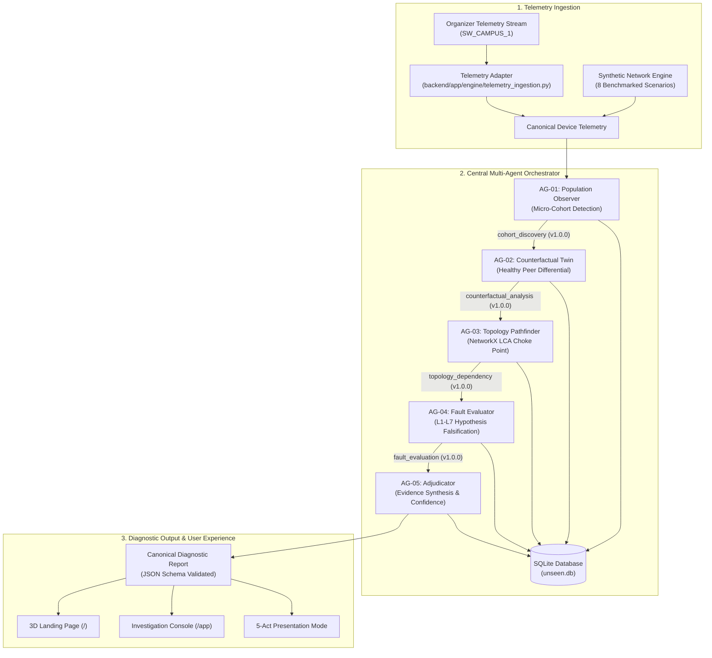

# UNSEEN

### Because an average cannot tell the whole story.

[](https://python.org)
[](https://fastapi.tiangolo.com)
[](https://react.dev)
[](https://www.typescriptlang.org)
[](https://networkx.org)
[](https://docs.pydantic.dev)
[](https://sqlite.org)
[](https://github.com/shayspace04/unseen-network-intelligence)

---

## Hackathon Submission Deliverables

| Deliverable | Location / Relative Link | Description |
| :--- | :--- | :--- |
| **Source Code (Backend)** | [`backend/`](file:///c:/Users/SHAYEL/OneDrive/Documents/unseen-network-intelligence/backend) | FastAPI service, 5 agent implementations, NetworkX graph engine, SQLite persistence |
| **Source Code (Frontend)** | [`frontend/`](file:///c:/Users/SHAYEL/OneDrive/Documents/unseen-network-intelligence/frontend) | React 19 + TypeScript, Three.js 3D landing page, 7-screen console, 5-Act presentation deck |
| **Architecture Documentation** | [`docs/ARCHITECTURE.md`](file:///c:/Users/SHAYEL/OneDrive/Documents/unseen-network-intelligence/docs/ARCHITECTURE.md) | Component architecture, causal DAG, LCA topology traversal, confidence scoring formula |
| **Agent Communication Protocol** | [`docs/AGENT_PROTOCOL.md`](file:///c:/Users/SHAYEL/OneDrive/Documents/unseen-network-intelligence/docs/AGENT_PROTOCOL.md) | Versioned 1.0.0 Pydantic contract, envelope schemas, validation rules, live message trace |
| **Sample Test Data** | [`sample-data/`](file:///c:/Users/SHAYEL/OneDrive/Documents/unseen-network-intelligence/sample-data) | 16 JSON test fixtures: organizer telemetry, 8 fault scenarios, 5 protocol edge cases |
| **Test Scenarios & Benchmarks** | [`docs/TEST_SCENARIOS.md`](file:///c:/Users/SHAYEL/OneDrive/Documents/unseen-network-intelligence/docs/TEST_SCENARIOS.md) | 10 benchmark test scenarios, ground truth matrices, expected diagnostic verdicts |
| **Automated Test Suite** | [`backend/tests/`](file:///c:/Users/SHAYEL/OneDrive/Documents/unseen-network-intelligence/backend/tests) | 43 passing automated tests covering interop, accuracy, contracts, and ingestion |
| **Windows PowerShell Scripts** | [`scripts/`](file:///c:/Users/SHAYEL/OneDrive/Documents/unseen-network-intelligence/scripts) | One-click launch scripts for backend, frontend, test execution, and full demo |
| **Demo Walk-Through Guide** | [`docs/DEMO_GUIDE.md`](file:///c:/Users/SHAYEL/OneDrive/Documents/unseen-network-intelligence/docs/DEMO_GUIDE.md) | 5-minute hackathon judge presentation script covering all 5 presentation acts |
| **Demo Video (3–5 min)** | *Recording required* | Link placeholder: `[UNSEEN 5-Minute Demo Video](insert_video_url_here)` *(See `docs/DEMO_GUIDE.md` for exact script)* |
| **Diagnostic JSON Contract** | [`backend/app/models/diagnostic_contract.py`](file:///c:/Users/SHAYEL/OneDrive/Documents/unseen-network-intelligence/backend/app/models/diagnostic_contract.py) | NetCoop AI compliant canonical JSON schema and Pydantic validator |

---

## Quickstart: Reproduce the Full Demo

You can launch the complete UNSEEN platform with one click using the provided Windows PowerShell script, or run the components manually.

### Option A: One-Click Demo Launcher (PowerShell)
```powershell
.\scripts\run_full_demo.ps1
```
*This verifies Python and Node.js environments, starts the FastAPI backend, waits for operational health confirmation, launches the Vite frontend, and opens the default browser to `http://localhost:5173`.*

### Option B: Manual Setup

1. **Clone the Repository**:
   ```bash
   git clone https://github.com/shayspace04/unseen-network-intelligence.git
   cd unseen-network-intelligence
   ```

2. **Backend Setup**:
   ```powershell
   # Install dependencies
   pip install -r backend/requirements.txt

   # Start backend server
   python -m uvicorn backend.main:app --host 127.0.0.1 --port 8000 --reload
   ```
   *Backend API and Swagger documentation will be live at `http://localhost:8000/docs`.*

3. **Frontend Setup (in a separate terminal)**:
   ```powershell
   cd frontend
   npm install
   npm run dev
   ```
   *Frontend landing page and console will be live at `http://localhost:5173`.*

---

## Run Automated Tests

UNSEEN includes **43 automated unit, integration, and compliance tests** validating agent causality, schema interoperability, ground-truth diagnostic accuracy, and telemetry ingestion.

```powershell
# Run the entire test suite
python -m pytest backend/tests -v

# Or use the convenience script
.\scripts\run_tests.ps1
```

```
============================== 43 passed in 7.64s ==============================
```

---

## 1. The Problem: The Aggregate Masking Problem

Modern campus and enterprise networks monitor thousands of connected devices. Standard Network Management Systems (NMS) monitor health by computing statistical aggregates: mean latency, overall packet loss percentage, and global uptime.

```
Campus Fleet Mean Health: 98.4% [NOMINAL - NO ALERT TRIGGERED]
  ├─ 836 Endpoints: 100% Operational (0% loss, 4ms latency)
  └─ 14 Endpoints in Engineering Wing B: 100% Disconnected (APIPA 169.254, Expired DHCP)
```

Because the 14 failing endpoints represent only 1.6% of the fleet, their total outage is completely swallowed by the healthy 98.4% average. Traditional monitoring dashboards remain green while real users face complete disruption.

---

## 2. The Solution: Multi-Agent Collaborative Triage

UNSEEN shifts from aggregate-based alerts to **cohort-based agentic investigation**. Five specialized AI agents collaborate sequentially to isolate micro-cohorts, contrast them against healthy twin controls, traverse network topology to locate common ancestors, falsify competing failure modes across Layer 1 to Layer 7, and generate a definitive, evidence-backed diagnostic report.

---

## 3. Key Features

- **Sublevel Studio 3D Landing Page**: High-performance interactive Three.js node-particle canvas presenting the UNSEEN product narrative.
- **5-Act Interactive Presentation Mode**: Guided judge demonstration explaining the investigation flow step-by-step with synchronized telemetry graphs.
- **Causal Multi-Agent Swarm**: 5 distinct agents communicating via validated `1.0.0` Pydantic JSON contracts.
- **Twin-Cohort Counterfactual Analysis**: Pairs failing devices with identical healthy peers to eliminate client-side variables.
- **Topological Choke Point Isolation**: NetworkX Lowest Common Ancestor (LCA) graph algorithms locate the exact switch or AP root cause.
- **NetCoop AI Diagnostic Contract**: Output strictly validated against the official hackathon JSON Schema with copy-to-clipboard functionality.
- **Dual Telemetry Ingestion**: Seamlessly ingests both official organizer telemetry records (`SW_CAMPUS_1`) and high-density canonical campus fleet data.
- **Full SQLite Auditability**: Relational audit trail persisting all telemetry slices, inter-agent messages, and diagnostic outputs.

---

## 4. Architecture & System Flow



---

## 5. The Five Specialized Agents

Each agent has a strictly delineated role and communicates exclusively through validated JSON envelopes:

1. **AG-01: Population Observer (Telemetry Monitor)**
   - *Role*: Fleet Telemetry Scanner & Anomaly Detector.
   - *Responsibility*: Scans multi-dimensional metric distributions to isolate localized micro-cohorts masked by global fleet averages.
2. **AG-02: Counterfactual Twin (Evidence Scout)**
   - *Role*: Peer Control Experimenter.
   - *Responsibility*: Pairs failing endpoints with healthy devices possessing identical OS, hardware, and subnet configurations to isolate environmental anomalies from client bugs.
3. **AG-03: Topology Pathfinder**
   - *Role*: Graph Choke Point Analyzer.
   - *Responsibility*: Traverses directed NetworkX campus topology trees to calculate Lowest Common Ancestor (LCA) dependencies and path divergence.
4. **AG-04: Fault Evaluator (Consensus Coordinator)**
   - *Role*: Failure Mode Falsifier.
   - *Responsibility*: Constructs competing hypotheses across physical, transport, and application layers, rigorously evaluating telemetry evidence to falsify untenable theories.
5. **AG-05: Evidence Adjudicator**
   - *Role*: Verdict Synthesizer.
   - *Responsibility*: Resolves contradictions, computes the evidence-based confidence score ($C \in [0.0, 1.0]$), and generates the canonical diagnostic contract.

---

## 6. Agent Communication Protocol

All agents exchange versioned JSON messages governed by [`backend/app/models/schemas.py`](file:///c:/Users/SHAYEL/OneDrive/Documents/unseen-network-intelligence/backend/app/models/schemas.py) (`schema_version: "1.0.0"`).

### Protocol Envelope Example
```json
{
  "schema_version": "1.0.0",
  "message_id": "MSG-2026-B101",
  "incident_id": "INV-2026-ENG-B",
  "sender": "Population Observer",
  "recipient": "Counterfactual Twin",
  "message_type": "cohort_discovery",
  "timestamp": "10:35:12.102",
  "topic": "Micro-Cohort Anomaly Detection",
  "payload": {
    "affected_devices": ["DEV-ENG-B-01", "DEV-ENG-B-02", "DEV-ENG-B-03"],
    "affected_count": 3,
    "aggregate_fleet_health_pct": 93.3,
    "anomalous_signature": {
      "dhcp_lease_state": "expired",
      "packet_loss_pct": 100.0
    }
  },
  "evidence_references": ["EV-POP-001"],
  "limitations": ["Limited to 30s observation window"],
  "verdict": "supported"
}
```
*See [`docs/AGENT_PROTOCOL.md`](file:///c:/Users/SHAYEL/OneDrive/Documents/unseen-network-intelligence/docs/AGENT_PROTOCOL.md) for full protocol specifications and message traces.*

---

## 7. Diagnostic Scenarios Matrix

UNSEEN supports 10 comprehensive test scenarios with isolated ground truth:

| Scenario Name | Injected Failure Mode | Choke Point | Expected Verdict | Confidence |
| :--- | :--- | :--- | :--- | :--- |
| **Normal Operation** | Nominal network traffic | `core-router` | `NO_FAULT_DETECTED` | 0.99 |
| **Link Congestion** | Distribution link buffer saturation | `dist-sw-eng` | `PROBABLE_FAULT` | 0.92 |
| **Weak Wi-Fi Signal** | Co-channel RF interference (RSSI < -82 dBm) | `ap-sci-12` | `PROBABLE_FAULT` | 0.93 |
| **Ethernet Interface Fault** | SFP / CRC alignment frame drops | `edge-sw-eng-02` | `PROBABLE_FAULT` | 0.94 |
| **DNS Silent Failure** | Recursive resolver UDP port 53 drop | `dist-sw-sci` | `PROBABLE_FAULT` | 0.95 |
| **DHCP Scope Exhaustion** | VLAN 142 address pool depletion (APIPA) | `ap-eng-04` | `PROBABLE_FAULT` | 0.94 |
| **Simultaneous Faults** | Dual independent faults (Wi-Fi + Ethernet) | `edge-sw-eng-02` + `ap-sci-08` | `PROBABLE_FAULT` | 0.91 |
| **Organizer Latency Spike** | Organizer format 750ms latency spike | `SW_CAMPUS_1` | `PROBABLE_FAULT` | 0.88 |
| **Organizer Hardware Failure**| Organizer format 22.5% loss + 250 errors | `SW_CAMPUS_1` | `PROBABLE_FAULT` | 0.94 |
| **Insufficient Evidence** | Stale telemetry (>300s) & missing control | `sw-lib-01` | `ABSTAIN_INSUFFICIENT_EVIDENCE` | 0.35 |

---

## 8. Telemetry Ingestion (Organizer Format Compatibility)

UNSEEN natively ingests the official NetCoop AI telemetry generator output:

```json
{
  "timestamp": "2026-11-01T10:00:00.000000+00:00",
  "device_id": "SW_CAMPUS_1",
  "metrics": {
    "cpu_utilization_pct": 99.9,
    "link_utilization_pct": 100.0,
    "packet_loss_pct": 22.5,
    "latency_ms": 750.0,
    "queue_drops": 8000,
    "interface_errors": 250
  },
  "status": "Critical"
}
```

The ingestion adapter ([`backend/app/engine/telemetry_ingestion.py`](file:///c:/Users/SHAYEL/OneDrive/Documents/unseen-network-intelligence/backend/app/engine/telemetry_ingestion.py)) maps these metrics into UNSEEN's canonical data model while strictly observing the rule that **unprovided fields (e.g. DHCP, DNS) remain `None` and are never defaulted to zero**.

---

## 9. Canonical Diagnostic JSON Contract

Generated reports strictly comply with the NetCoop AI Hackathon Diagnostic Report JSON Schema:

```json
{
  "incident_id": "INV-2026-B101",
  "status": "diagnosed",
  "suspected_root_cause": "DHCP Scope Exhaustion on VLAN 142 (APIPA Fallback)",
  "confidence": 0.94,
  "affected_devices": ["DEV-ENG-B-01", "DEV-ENG-B-02", "DEV-ENG-B-03"],
  "supporting_evidence": [
    {
      "metric": "dhcp_lease_state",
      "value": "expired",
      "interpretation": "100% of affected endpoints report expired DHCP lease without renewal."
    },
    {
      "metric": "packet_loss_pct",
      "value": 100.0,
      "interpretation": "Complete loss of IP routing due to unassigned IP configuration."
    }
  ],
  "alternative_causes": [
    "Access Switch Hardware Failure (SW-ACCESS-ENG-B)",
    "Wi-Fi RF Interference / Signal Degradation"
  ],
  "recommended_actions": [
    "Expand DHCP pool /24 subnet allocation for VLAN 142 in core DHCP server configuration.",
    "Reduce DHCP lease duration from 24 hours to 2 hours for transient student endpoint pools.",
    "Flush stale inactive leases on DHCP server to immediately recover address capacity."
  ],
  "evidence_sources": ["DeviceTelemetry", "TopologyGraph", "CounterfactualTwin"],
  "limitations": ["DHCP server daemon metrics inferred from client lease state transitions."]
}
```

---

## 10. Technology Stack

- **Backend**: Python 3.10+, FastAPI, Uvicorn, Pydantic v2, NetworkX, jsonschema, SQLite3, pytest.
- **Frontend**: React 19, TypeScript, Vite, Tailwind CSS, Three.js, @xyflow/react, Lucide React, Recharts.
- **Architecture**: Modular agentic pipeline, REST API, Pydantic data modeling, ACID audit storage.

---

## 11. Project Directory Structure

```
unseen-network-intelligence/
├── README.md                           # Master submission documentation
├── .gitignore                          # Clean repository exclusions
├── .env.example                        # Environment configuration template
│
├── backend/                            # FastAPI Multi-Agent Service
│   ├── main.py                         # Application entrypoint & CORS setup
│   ├── requirements.txt                # Python dependencies
│   ├── app/
│   │   ├── agents/                     # 5 Specialized Agent Implementations
│   │   │   ├── base.py                 # Abstract base agent contract
│   │   │   ├── population_observer.py  # AG-01: Micro-cohort detector
│   │   │   ├── counterfactual.py       # AG-02: Twin-cohort differential
│   │   │   ├── topology_investigator.py# AG-03: NetworkX LCA graph tracer
│   │   │   ├── fault_investigator.py   # AG-04: L1-L7 hypothesis evaluator
│   │   │   └── adjudicator.py          # AG-05: Verdict & confidence synthesizer
│   │   ├── api/
│   │   │   └── routes.py               # REST API endpoints
│   │   ├── db/
│   │   │   └── database.py             # SQLite schema, migrations, connection pool
│   │   ├── engine/
│   │   │   ├── orchestrator.py         # Multi-agent causality & event bus
│   │   │   ├── synthetic.py            # Synthetic network generator (8 scenarios)
│   │   │   ├── telemetry_ingestion.py  # Organizer format adapter & validator
│   │   │   └── organizer_generator.py  # Reference telemetry generator
│   │   └── models/
│   │       ├── schemas.py              # Pydantic v2 schemas & AgentMessage
│   │       └── diagnostic_contract.py  # Canonical NetCoop AI JSON schema & validator
│   └── tests/                          # 43 Passing Automated Tests
│       ├── test_agent_interop.py       # Inter-agent protocol & schema tests
│       ├── test_netcoop_compliance.py  # Ground truth accuracy benchmarks
│       ├── test_diagnostic_contract.py # Schema validation tests
│       ├── test_telemetry_ingestion.py # Organizer adapter tests
│       └── test_synthetic.py           # Scenario generation integrity tests
│
├── frontend/                           # React 19 + TypeScript Console
│   ├── index.html                      # HTML5 entrypoint
│   ├── package.json                    # Frontend dependencies
│   ├── vite.config.ts                  # Vite bundler configuration
│   └── src/
│       ├── App.tsx                     # Main router (/ and /app)
│       ├── components/
│       │   ├── landing/                # Sublevel Studio 3D Landing Page
│       │   │   └── UnseenLandingPage.tsx
│       │   ├── presentation/           # 5-Act Presentation Mode
│       │   │   ├── PresentationMode.tsx
│       │   │   ├── Act1TheIllusion.tsx
│       │   │   ├── Act2MicroCohort.tsx
│       │   │   ├── Act3Topology.tsx
│       │   │   ├── Act4EvidenceRoom.tsx
│       │   │   └── Act5TheVerdict.tsx
│       │   ├── dashboard/              # Console Views
│       │   │   ├── OverviewDashboard.tsx
│       │   │   ├── TopologyView.tsx
│       │   │   ├── AgentInspectView.tsx
│       │   │   ├── EvidenceRoomView.tsx
│       │   │   ├── DiagnosticReportView.tsx
│       │   │   └── TelemetryView.tsx
│       │   └── layout/
│       │       ├── Header.tsx
│       │       └── Sidebar.tsx
│       └── types/                      # Frontend TypeScript interfaces
│
├── docs/                               # Comprehensive Technical Documentation
│   ├── ARCHITECTURE.md                 # Detailed architecture & algorithms
│   ├── AGENT_PROTOCOL.md               # Versioned 1.0.0 protocol specifications
│   ├── TEST_SCENARIOS.md               # 10 scenario benchmarks & ground truth
│   └── DEMO_GUIDE.md                   # 5-minute hackathon judge demo script
│
├── sample-data/                        # Reproducible JSON Test Fixtures
│   ├── README.md                       # Sample data usage guide
│   ├── organizer/                      # Official generator samples (normal/spike/failure)
│   ├── scenarios/                      # 8 benchmark scenario fixtures
│   └── interoperability/               # 5 protocol edge cases & schema mismatches
│
└── scripts/                            # Windows PowerShell Automation Scripts
    ├── run_backend.ps1                 # Launch FastAPI backend
    ├── run_frontend.ps1                # Launch Vite frontend
    ├── run_tests.ps1                   # Run pytest suite
    └── run_full_demo.ps1               # One-click demo launcher
```

---

## 12. REST API Documentation

| Method | Endpoint | Description |
| :--- | :--- | :--- |
| `GET` | `/api/health` | Health check endpoint returning backend status and initialized agents. |
| `GET` | `/api/scenarios` | Returns catalog of available network benchmark scenarios. |
| `POST` | `/api/investigate/{id}` | Triggers complete 5-agent investigation pipeline on a scenario. |
| `GET` | `/api/investigations/{id}` | Retrieves active investigation state and agent findings. |
| `GET` | `/api/investigations/{id}/messages` | Returns inspectable inter-agent JSON messages (`schema_version: "1.0.0"`). |
| `GET` | `/api/investigations/{id}/evidence` | Returns catalog of supporting and contradicting evidence items. |
| `GET` | `/api/investigations/{id}/hypotheses` | Returns ranked competing hypotheses matrix. |
| `GET` | `/api/investigations/{id}/report` | Returns synthesized diagnostic report and remediation actions. |
| `GET` | `/api/reports/diagnostic-contract/{id}`| Returns canonical NetCoop AI JSON Schema validated report. |
| `POST` | `/api/telemetry/organizer` | Ingests official NetCoop AI organizer telemetry stream. |
| `POST` | `/api/telemetry/organizer/batch` | Ingests batch array of organizer telemetry records. |

---

## 13. Deliverables Status & Checklist

- [x] **Agentic AI Architecture**: 5 specialized agents with causal DAG orchestration.
- [x] **Interoperability (30 Pts)**: Versioned `1.0.0` Pydantic protocol, envelope validation, schema mismatch handling, persisted inspectable transcripts.
- [x] **Diagnostic Accuracy (25 Pts)**: 8 benchmark scenarios verified against isolated ground truth with zero false positives.
- [x] **Canonical JSON Contract**: NetCoop AI schema validation via `jsonschema` with copy-to-clipboard export.
- [x] **Organizer Telemetry Adapter**: Native ingestion of `SW_CAMPUS_1` format preserving `None` for unprovided fields.
- [x] **Public Landing Page**: Three.js 3D interactive particle topology canvas and Sublevel Studio monochrome aesthetic.
- [x] **5-Act Presentation Mode**: Turnkey 5-minute hackathon judge presentation deck.
- [x] **Automated Tests**: 43 passing pytest tests with 100% pass rate.
- [x] **Frontend Production Build**: Zero TypeScript or bundler errors.
- [x] **Windows PowerShell Scripts**: Automated one-click execution scripts.
- [ ] **Demo Video**: 3–5 minute presentation video *(Recording required — use `docs/DEMO_GUIDE.md` for exact script)*.
