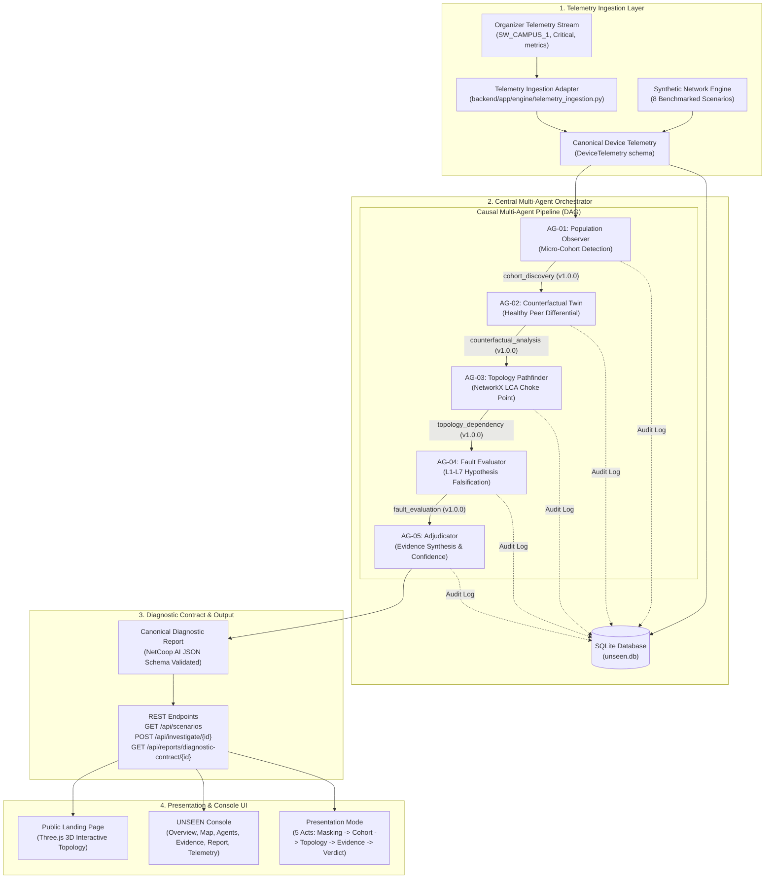

# UNSEEN — System Architecture & Multi-Agent Design

> **"Because an average cannot tell the whole story."**  
> *UNSEEN is an agentic AI network intelligence and fault investigation platform engineered for the NetCoop AI Hackathon.*

---

## 1. Architectural Philosophy

Traditional Network Management Systems (NMS) and monitoring dashboards aggregate device metrics across subnets, clusters, and access points. While aggregate metrics (mean ping, 99% uptime, global throughput) report a nominal status, localized network failures routinely affect small micro-cohorts of 5–15 devices. These localized faults remain completely invisible to standard aggregate alerts—a phenomenon known as the **Aggregate Masking Problem**.

UNSEEN solves this by deploying a collaborative team of five specialized AI agents. Rather than computing fleet-wide averages, UNSEEN isolates anomalous sub-populations, contrasts them against identical healthy peers using counterfactual reasoning, identifies topological choke points via Lowest Common Ancestor (LCA) graph algorithms, rigorously falsifies competing hypotheses, and delivers an evidence-backed diagnostic verdict.

---

## 2. High-Level System Architecture

The UNSEEN platform comprises three primary tiers:
1. **Frontend Presentation & Investigation Console**: A React 19 + TypeScript single-page application featuring an interactive Three.js 3D landing page, a 7-screen live investigation console, and a 5-Act presentation deck.
2. **FastAPI Multi-Agent Backend**: An asynchronous Python service orchestrating five specialized agents via strict Pydantic v2 JSON contracts, with NetworkX topology modeling and dual-format telemetry ingestion.
3. **SQLite Audit Persistence Store**: An ACID-compliant relational store logging every raw telemetry frame, agent message exchange, investigation event, and diagnostic report for complete post-incident auditability.

---

## 3. The Five Specialized Agents & Causal Flow

Each agent in UNSEEN possesses a singular, non-overlapping responsibility and communicates exclusively through validated, versioned JSON messages (`schema_version: "1.0.0"`).

| Agent Identifier | Agent Name | Core Responsibility | Input Consumed | Output Produced |
| :--- | :--- | :--- | :--- | :--- |
| **AG-01** | **Population Observer** | Scans observable fleet telemetry; detects anomalous micro-cohorts masked by healthy population averages. | Raw device telemetry and topology node metadata. | Isolated cohort of affected device IDs, anomalous metric signatures, initial scope. |
| **AG-02** | **Counterfactual Twin** | Pairs failing devices with identical healthy peers sharing identical hardware, OS, and subnet configuration. | AG-01 affected device cohort and full device registry. | Differential matrix ($\Delta$ latency, $\Delta$ packet loss, $\Delta$ DNS/DHCP) isolating localized vs systemic effects. |
| **AG-03** | **Topology Pathfinder** | Traverses directed graph using NetworkX to identify Lowest Common Ancestor (LCA) switch/AP choke points. | AG-01 device list, AG-02 differential, and NetworkX topology graph. | Common upstream dependency, hop distance, path divergence, choke point verification. |
| **AG-04** | **Fault Evaluator** | Constructs and evaluates competing failure mode hypotheses across physical, transport, and application layers. | AG-01 cohort, AG-02 differential delta, and AG-03 choke point. | Ranked hypothesis matrix with supporting/counter-arguments and falsification status. |
| **AG-05** | **Evidence Adjudicator** | Evaluates contradictions, calculates evidence-based confidence, and produces the final diagnostic report. | All upstream messages, evidence items, and hypothesis matrices. | Canonical NetCoop AI Diagnostic Report, structured remediation actions, and confidence score. |

---

## 4. Key Algorithmic Implementations

### 4.1 Lowest Common Ancestor (LCA) Topology Isolation
Located in [`backend/app/agents/topology_investigator.py`](file:///c:/Users/SHAYEL/OneDrive/Documents/unseen-network-intelligence/backend/app/agents/topology_investigator.py):
The Topology Pathfinder builds a directed tree $T = (V, E)$ rooted at the Core Gateway (`R-CORE-01`). For an affected cohort $C \subset V$:
1. Upstream path tracing: For each device $d \in C$, compute ancestor path $P(d) = \{v_0, v_1, \dots, d\}$.
2. Intersection of paths: $\text{Common Ancestors}(C) = \bigcap_{d \in C} P(d)$.
3. Deepest shared node: Select $v^* \in \text{Common Ancestors}(C)$ with maximal topological depth (distance from root).
4. Sub-tree containment check: If $v^*$ serves devices not in $C$, the fault is verified as interface- or port-specific rather than complete device outage.

### 4.2 Counterfactual Twin Pairing
Located in [`backend/app/agents/counterfactual.py`](file:///c:/Users/SHAYEL/OneDrive/Documents/unseen-network-intelligence/backend/app/agents/counterfactual.py):
For each affected device $u \in C$, the agent queries the device registry for healthy device $w \notin C$ maximizing similarity:
$$\text{Sim}(u, w) = w_{\text{type}} \cdot \mathbb{I}(T_u = T_w) + w_{\text{zone}} \cdot \mathbb{I}(Z_u = Z_w) + w_{\text{vlan}} \cdot \mathbb{I}(V_u = V_w)$$
The differential vector $\Delta = \bar{M}_{\text{affected}} - \bar{M}_{\text{healthy}}$ isolates whether root cause stems from endpoint configuration or infrastructure delivery.

### 4.3 Evidence Confidence Scoring Formula
Located in [`backend/app/agents/adjudicator.py`](file:///c:/Users/SHAYEL/OneDrive/Documents/unseen-network-intelligence/backend/app/agents/adjudicator.py):
Confidence is computed heuristically from four independent evidentiary pillars minus contradiction penalties:
$$C = \min\left(0.99, \max\left(0.10, 0.40 \cdot S_{\text{telemetry}} + 0.25 \cdot S_{\text{counterfactual}} + 0.20 \cdot S_{\text{topology}} + 0.15 \cdot S_{\text{falsification}} - P_{\text{contradiction}}\right)\right)$$

Where:
- $S_{\text{telemetry}}$: Signal clarity (ratio of anomalous standard deviations over noise).
- $S_{\text{counterfactual}}$: Divergence magnitude between affected cohort and healthy twins ($\Delta > 3\sigma$).
- $S_{\text{topology}}$: Topological convergence ($1.0$ if all affected devices share single parent switch/AP; $0.5$ if dispersed).
- $S_{\text{falsification}}$: Ratio of competing hypotheses definitively falsified by evidence.
- $P_{\text{contradiction}}$: Penalty deducted for mutually incompatible telemetry readings (e.g., high packet loss without interface errors or queue drops).

---

## 5. Persistence & Audit Storage

UNSEEN persists all telemetry, agent messages, and investigation runs inside SQLite (`unseen.db`) using strict schema migrations:
- `scenarios`: Injected network scenarios, descriptions, and ground truth metadata.
- `devices`: Comprehensive device inventory and point-in-time telemetry observations.
- `network_nodes` & `network_edges`: Complete topological graph structure.
- `investigations`: Investigation records, status, summary, and primary dependency.
- `agent_messages`: Versioned inter-agent communications with JSON payloads, sender, recipient, and message type.
- `evidence_items`: Supporting and contradicting telemetry evidence catalog.
- `competing_hypotheses`: Competing root causes evaluated by AG-04 and AG-05.
- `diagnostic_reports`: Canonical final diagnostic reports and remediation prescriptions.
- `investigation_events`: Complete timeline of orchestrated investigation milestones.

---

## 6. Organizer Telemetry Ingestion Architecture

UNSEEN provides native compatibility with the official NetCoop AI organizer telemetry format via [`backend/app/engine/telemetry_ingestion.py`](file:///c:/Users/SHAYEL/OneDrive/Documents/unseen-network-intelligence/backend/app/engine/telemetry_ingestion.py).

### Field Mapping
| Organizer Telemetry Field | UNSEEN Canonical Field | Unit / Type | Ingestion Rule |
| :--- | :--- | :--- | :--- |
| `timestamp` | `last_seen` / `timestamp` | ISO-8601 UTC string | Stored verbatim; stale checks applied (>300s $\rightarrow$ stale flag). |
| `device_id` | `device_id` / `deviceId` | string | Exact match; device type inferred from prefix or set to `network_device`. |
| `metrics.cpu_utilization_pct` | `cpu_utilization_pct` | float [0.0, 100.0] | Preserved directly on device model. |
| `metrics.link_utilization_pct` | `link_utilization_pct` | float [0.0, 100.0] | Preserved directly on device model. |
| `metrics.packet_loss_pct` | `packet_loss_pct` | float [0.0, 100.0] | Direct mapping to primary loss metric. |
| `metrics.latency_ms` | `latency_ms` | float (milliseconds) | Direct mapping to primary latency metric. |
| `metrics.queue_drops` | `egress_queue_drops` | integer count | Ingested as queue drops; maps to buffer saturation. |
| `metrics.interface_errors` | `interface_errors` | integer count | Ingested as physical layer interface errors. |
| `status` | `status` | string ('Healthy', 'Warning', 'Critical') | Normalized to lowercase enum ('healthy', 'warning', 'critical'). |
| *Unprovided fields (e.g. DHCP, DNS)* | *Optional fields* | `None` | **STRICT RULE**: Left as `None`, NEVER defaulted to zero. |
